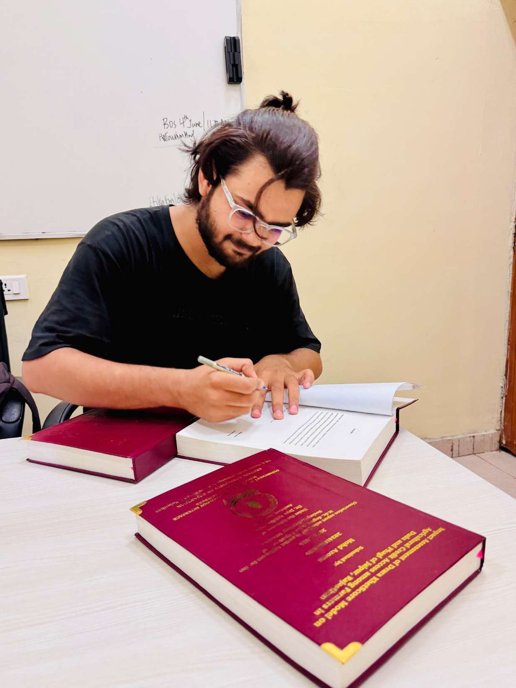

# Agricultural Credit Access and the Dvara-Linked KhetScore Model

This dissertation research examines how farmers experience a technology-supported agricultural lending process in selected rural areas of Jaipur district, Rajasthan.

## Study overview

The study focuses on the Dvara-linked KhetScore model and asks how the lending process affects practical access to credit, how field-level assistance shapes borrower experience, and what barriers remain around awareness, loan information, repayment and agricultural risk.

- **Study area:** selected villages in Dudu and Phagi tehsils, Jaipur district
- **Research design:** descriptive and exploratory mixed methods
- **Farmer survey:** 116 purposively selected participants (50 from Dudu and 66 from Phagi)
- **Additional evidence:** interviews with four Dvara staff members, field observations, telephonic interactions and one contextual focus group with six local stakeholders
- **Degree context:** M.Sc. Digital Society dissertation research, Central University of Rajasthan, session 2024-2026

## Findings summarized

Among 103 participants who answered a question about previous borrowing, 31.1% reported that they had not taken a loan before joining the Dvara/KhetScore-linked process. This is a descriptive result for the study sample, not an estimate for all farmers.

Many participants described the process as relatively accessible and relied on field officers or local contacts to navigate it. At the same time, awareness of KhetScore was limited for many borrowers, and land-related verification continued to matter. The study highlights that access to a loan does not by itself ensure that borrowers understand the assessment process, repayment conditions or their options for support.

## Interpretation and limitations

The sample was purposive and limited to selected operational areas. Findings rely partly on self-reported experiences and do not establish causal or long-term effects on income, crop yields or productivity. The research did not audit the model's internal algorithm or independently verify each participant's loan terms.

The study's measured conclusion is that the lending process appears to have offered an additional route to credit for some participants. Its inclusive value also depends on clear borrower information, awareness, responsive field support and attention to livelihood and agricultural risks.

## Public materials

- [Read the privacy-reviewed dissertation research brief (PDF)](../../docs/assets/dissertation/khetscore-dissertation-research-brief.pdf)
- [View the solo dissertation photograph](../../docs/assets/dissertation/azeem-dissertation-writing.jpg)

## Data and participant privacy

The full dissertation copy contains detailed anonymized participant stories, interview materials and photographs showing other people. Those materials are not included here because combinations of details and faces can create a risk of identification. No raw farmer-level data, interview transcripts, field notes or participant photographs are published in this repository. The PDF linked above is a portfolio summary, not the full-length dissertation.
