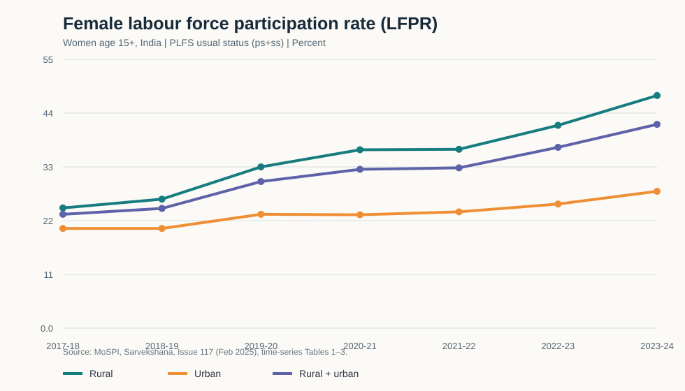
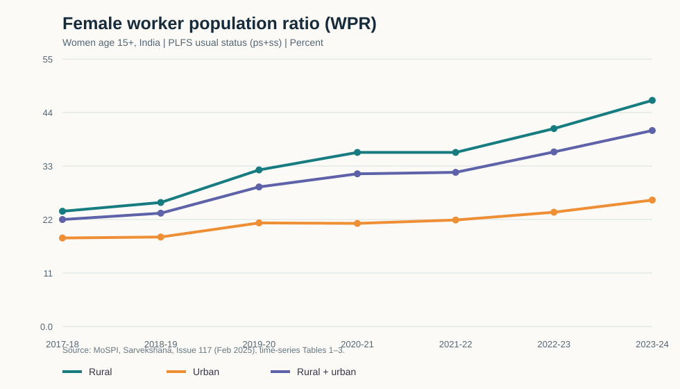
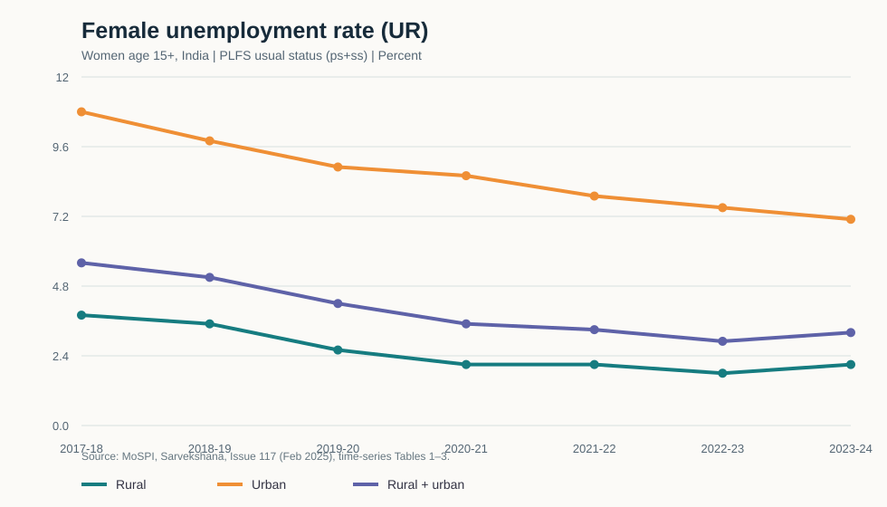

# Women’s labour force trends in India (PLFS, 2017–18 to 2023–24)

Descriptive analysis of female LFPR, WPR and unemployment rates for people aged 15+, comparing rural, urban and combined estimates across seven PLFS annual rounds.

## Main result

From 2017–18 to 2023–24, published all-India female LFPR rose from **23.3% to 41.7%** (+18.4 percentage points); WPR rose from **22.0% to 40.3%** (+18.3 pp). The unemployment rate moved from **5.6% to 3.2%** (−2.4 pp). LFPR rose by 23.0 pp in rural areas and 7.6 pp in urban areas.

These are descriptive rate changes. They do not establish why rates changed, whether work was paid or secure, or whether employment quality improved.

## Files and charts

- [Tidy dataset](data/female_labour_indicators_2017-18_to_2023-24.csv)
- [Reproducible plotting code](analysis/plot_indicators.py)
- [Female LFPR graph](figures/female_lfpr.svg)
- [Female WPR graph](figures/female_wpr.svg)
- [Female unemployment graph](figures/female_ur.svg)

## Definitions and limits

Rates are percentages for women age 15+. LFPR means working or seeking/available for work; WPR means employed; UR is unemployed people as a share of the labour force. All use PLFS usual status (principal status plus subsidiary status). The combined rural–urban rate is the official combined estimate, not an arithmetic average. Source values are rounded to one decimal place.

Participation rates do not show job type, hours, earnings, informality, unpaid family work or employment security. This historical series ends in 2023–24. MoSPI introduced a redesigned PLFS series for 2025; do not append newer values without checking methodological comparability.

Run `python analysis/plot_indicators.py` from this folder (requires Python 3 and Matplotlib) to recreate the SVG charts.

## Sources

- MoSPI, *Sarvekshana*, Issue 117, Feb. 2025, “Time Series of Key Labour Force Indicators in Usual Status (ps+ss),” Tables 1–3, PDF pp. 92–94 (printed pp. 86–89): [official PDF](https://mospi.gov.in/sites/default/files/publication_reports/Sarvekshna_117th_24022025.pdf).
- MoSPI, *Annual Report, PLFS, July 2023–June 2024*: [official PDF](https://mospi.gov.in/sites/default/files/publication_reports/AnnualReport_PLFS2023-24L2.pdf).
- Context on measuring women’s work: [PLOS ONE article on small-area estimation](https://journals.plos.org/plosone/article?id=10.1371/journal.pone.0317783). This project does not reproduce that study's estimates.

Only previously published aggregate statistics are included. No microdata or person-level records are included. Obtain PLFS microdata and its terms from [MoSPI’s microdata portal](https://microdata.gov.in/NADA/index.php/home); do not redistribute restricted files.
